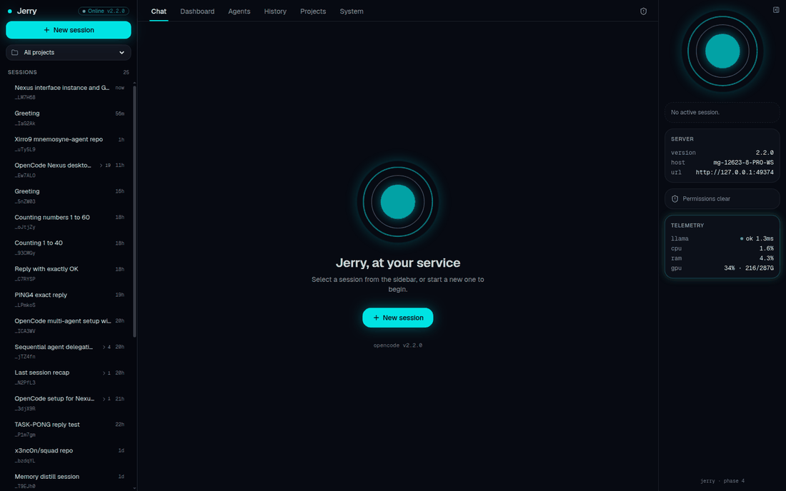
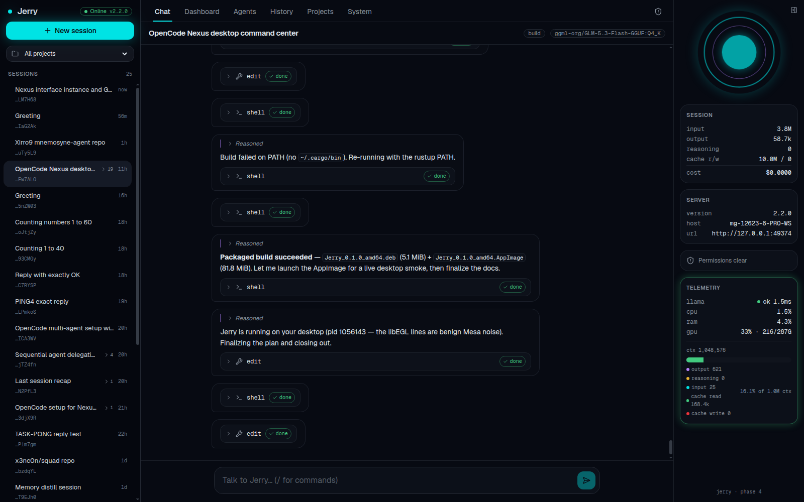
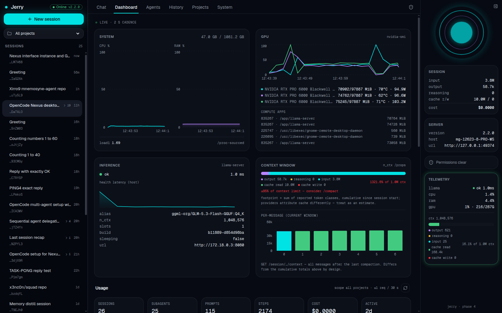
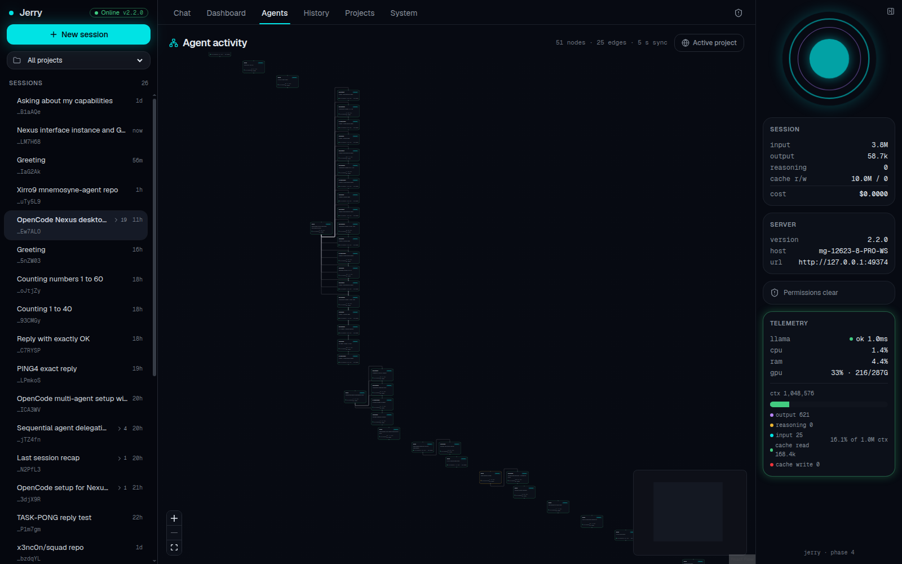
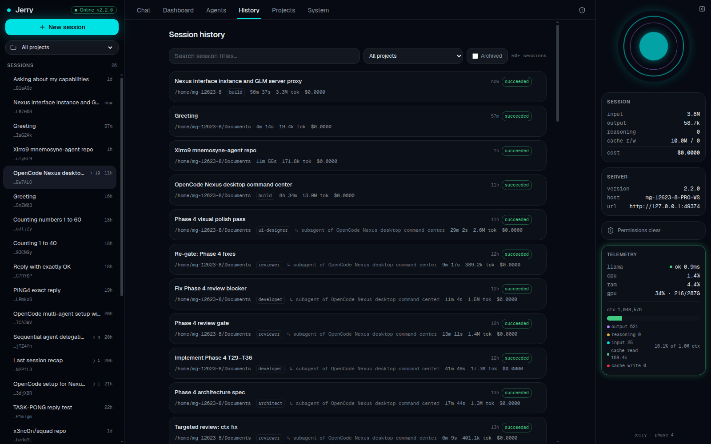
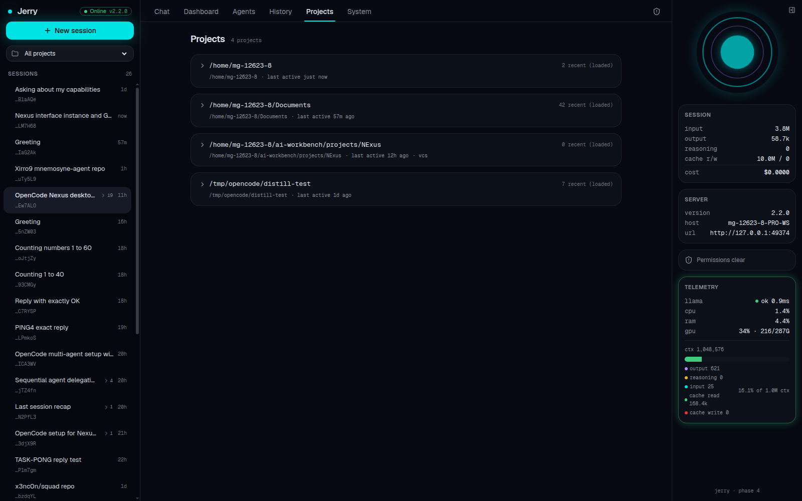
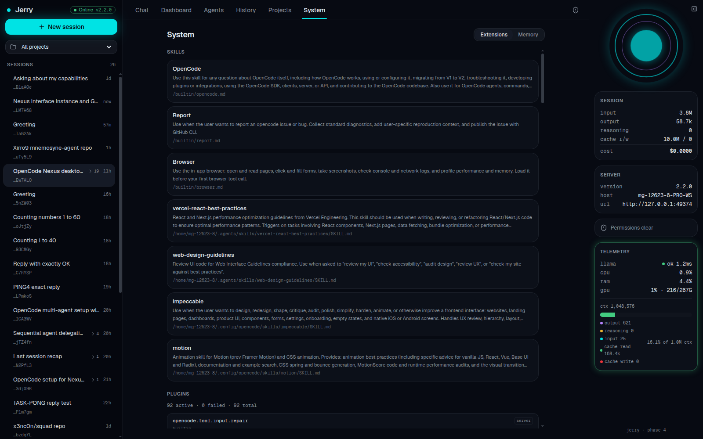

<div align="center">

# ✦ JERRY ✦

### Your machine, with a voice

**A premium AI desktop command center for the local [OpenCode](https://opencode.ai) harness.**
One window for your sessions, agents, tokens, cost, and the metal underneath — GPU, CPU, RAM, all live.

Product name **Jerry** (2026-11-05) · repo stays **NExus** · Tauri id `com.xirro9.jerry`




</div>

---

## 🚀 Launch Jerry

```bash
jerry          # detached launch — an already-running Jerry is focused instead
jerry --fg     # foreground, logs in the terminal
```

Install the terminal call:

```bash
cp bin/jerry ~/.local/bin/jerry && chmod +x ~/.local/bin/jerry
```

The launcher looks for the AppImage at
`src-tauri/target/release/bundle/appimage/Jerry_0.1.0_amd64.AppImage`
(override with the `JERRY_APP` env var). Desktop entries and a tray icon
(Show / Hide / Quit) ship alongside — closing the window hides Jerry to the
tray while sessions and telemetry keep running.

## 📸 The views

| | |
| --- | --- |
|  |  |
| **Chat** — markdown, tool cards, reasoning, live tokens | **Dashboard** — GPU/CPU/RAM, llama health, context window |
|  |  |
| **Agents** — live subagent graph (React Flow) | **History** — searchable archive across projects |
|  |  |
| **Projects** — workspace overview | **System** — skills, plugins, persistent memory |

## 💬 Talking to Jerry

| You do | Jerry says |
| --- | --- |
| Open the composer | *"Talk to Jerry… (/ for commands)"* |
| Send a prompt | *"Jerry is thinking…"* |
| Launch cold | *"Waking Jerry…"* |
| Connection drops | *"Jerry is unreachable — retrying"* |

Everything routes to **your local llama.cpp server** — no outside LLM APIs,
no hosted fallbacks, no telemetry leaving the box.

## ✨ What's inside

- **Sessions & chat** — full markdown chat, slash commands, reasoning blocks,
  per-message token & cost accounting, live SSE streaming.
- **Agent graph** — sessions and subagents rendered as a live React Flow graph.
- **Dashboard** — GPU / CPU / RAM / load rings, llama-server health, token and
  cost usage over time (Recharts).
- **History & projects** — searchable session history grouped by project.
- **System panel** — MCP server status and persistent memory viewers.

## 🏗️ Architecture (the interesting part)

> Jerry is a UI over the local OpenCode harness; the repo keeps the name NExus.
> Phases 1–4 are implemented — see [`docs/PLAN.md`](docs/PLAN.md) and
> [`docs/SPEC-PHASE{1..4}.md`](docs/).

<details>
<summary><b>🔐 Dev proxy & auth (Phase 1)</b></summary>

`npm run dev` proxies `/api/*` to the local OpenCode service, injecting HTTP
Basic auth read server-side from `~/.local/state/opencode/service.json`. The
password never reaches the browser. The **target URL is pinned at dev-server
boot** — if the service restarts on a *different port*, restart the dev server;
a password rotation self-heals on the next request (mtime-cached re-read).
Never bypass the proxy: `EventSource` cannot set auth headers itself.

</details>

<details>
<summary><b>🐚 Tauri shell & the transport seam (Phase 4)</b></summary>

Inside the desktop shell (`npm run tauri dev` / the packaged app), the same
client code talks through a `Transport` seam (`src/lib/transport/`) instead of
the dev proxy: detection is `"__TAURI_INTERNALS__" in window`. The Tauri
implementation invokes four Rust commands (`api_fetch`, `event_stream_start`,
`event_stream_stop`, `telemetry_snapshot`) — the password stays in Rust, the
SSE stream is pumped by a Rust task over a tauri IPC `Channel`, and host
telemetry loops run in Rust (`src-tauri/src/telemetry/`, 1:1 port of the dev
middleware's cadences and degradation semantics). A plain `npm run dev` in a
browser keeps the byte-identical Phase 1 proxy path. Both upstreams are plain
HTTP; reqwest ships without a TLS stack (add `rustls` if that ever changes).

The llama-server target is resolved once at app boot from `NEXUS_LLM_URL`
(default `http://172.18.0.3:8080`, the pinned container IP) — set the env var
before launching the app if the container IP changes.

Desktop conveniences: window state restore, single-instance focus, tray
(Show/Hide/Quit), and quit-on-close (closing the window exits the app).

</details>

<details>
<summary><b>📈 Telemetry middleware (Phase 2)</b></summary>

A Vite plugin (`src/server/telemetry.ts`) serves origin-relative
`/telemetry/snapshot` + `/telemetry/llm` JSON: CPU/RAM/load from `/proc`, GPU
via a long-lived `nvidia-smi -l 2` child, llama-server `/health` (timed) +
`/props`. It makes **zero OpenCode API calls**. The llama-server target is
resolved once at boot from `NEXUS_LLM_URL` (default `http://172.18.0.3:8080`,
the pinned container IP) — if the container IP ever changes, set the env var
and restart the dev server. Recovery after a llama container restart is
automatic (5 s health probe). Dev-server restarts wipe the ~10 min sample
rings; panels show an honest "warming up" state until they refill.

</details>

## 🧰 Stack (installed & verified)

| Layer | Package | Version |
| --- | --- | --- |
| Desktop shell | Tauri 2 (`@tauri-apps/cli`, `@tauri-apps/api`) | 2.12.x |
| UI runtime | React + TypeScript (Vite 8, oxc) | React 19.3 / TS 7 |
| Styling | Tailwind CSS (v4, `@tailwindcss/vite`) | 4.3.x |
| Components | shadcn/ui (radix base, Nova preset — Lucide/Geist) | initialized |
| Animation | Motion (`motion/react`) | 14.9.x |
| Flow diagrams | React Flow (`@xyflow/react`) | 12.12.x |
| Charts | Recharts | 3.10.x |
| Icons | Lucide (`lucide-react`) | 1.68.x |

## ⌨️ Developer commands

```bash
npm run dev          # Vite dev server (port 1420, fixed — Tauri dev URL)
npm run build        # tsc -b && vite build
npm run tauri dev    # desktop dev (exercises the Rust command path)
npm run tauri build  # deb + AppImage under src-tauri/target/release/bundle/
node scripts/gen-icons.mjs   # regenerate src-tauri/icons/*.png (dependency-free)
```

Component registries:

```bash
npx shadcn@latest add <component>                                        # shadcn/ui
npx shadcn@latest add "https://reactbits.dev/r/default/<Name>-TS-CSS"    # React Bits
```

Browse React Bits at [reactbits.dev](https://reactbits.dev).

## 📦 System deps

Linux webview dev packages (webkit2gtk-4.1, rsvg, appindicator) are installed —
`npm run tauri dev` works out of the box. Rust toolchain via rustup at `~/.cargo`.

## 🤖 Agent tooling (scoped to this project)

- `opencode.json` — project MCPs: `shadcn`, `chrome-devtools`, `context7`
  (Playwright and Motion are global; Motion MCP is hosted at mcp.motion.dev).
- Global skills apply here: `impeccable`, `motion`, `vercel-react-best-practices`,
  `web-design-guidelines` (see `~/.config/opencode/skills/.usage.json`).

---

<div align="center">
<sub><b>Jerry</b> — built on the OpenCode harness · NExus repo · v0.1.0</sub>
</div>
